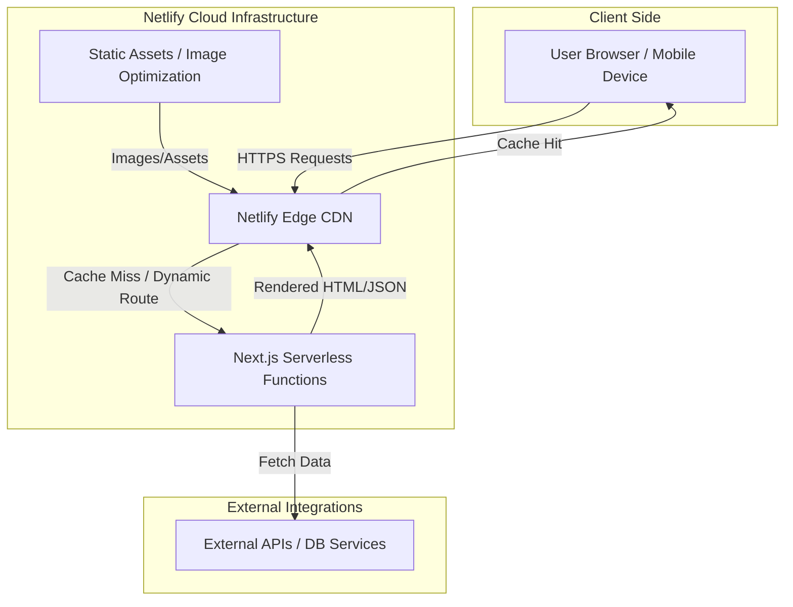

# Project Report: Cloud-Based Web System Development
**Project Name:** Dahel Technologies Platform  
**Live Deployment:** [https://daheltech.netlify.app/](https://daheltech.netlify.app/)

---

## 1. Identify a Real-World Problem

### Context and Literature Review
As global digital transformation accelerates, the demand for highly skilled technology professionals—particularly in Data Analytics, Software Engineering, and AI—has vastly outpaced supply. Research indicates a significant "skills gap," where traditional educational institutions and legacy training centers fail to equip learners with hands-on, production-ready skills. Furthermore, existing EdTech platforms are often fragmented; users must utilize one platform to learn, another to practice, and yet another to be assessed. 

### The Problem
Traditional training models lack a cohesive ecosystem that seamlessly integrates structured learning, personalized organizational training, continuous assessment, and practical application. This fragmentation leads to lower completion rates, poor knowledge retention, and an inability for learners to seamlessly transition into technical roles.

### Proposed Solution
The **Dahel Technologies Platform** was conceptualized and built to solve this fragmentation. It is a modern, premium cloud-based ecosystem that moves away from the traditional training company model into an outcome-focused hub. The platform unifies four key journeys:
1. **Learn:** Structured, practical resources for in-demand skills (Python, SQL, Power BI).
2. **Train:** Personalized pipelines for private, group, and corporate upskilling.
3. **Assess:** Integrated knowledge testing and performance tracking via bespoke tools like **Quizarly**.
4. **Build:** Access to practical, internally-built AI and tech tools (Checkamo, Ekko Now).

---

## 2. Design the System Architecture

To ensure the solution is robust, scalable, and highly performant, a modern JavaScript ecosystem was selected. The architecture leverages Server-Side Rendering (SSR) and Edge networks to deliver a premium user experience globally.

### Technology Stack & Justification
*   **Core Framework:** **Next.js (App Router)** paired with **React 19**. Next.js was chosen for its hybrid static and server rendering capabilities, which drastically improve SEO, initial page load times, and Core Web Vitals compared to traditional Single Page Applications (SPAs).
*   **Styling & UI:** **Tailwind CSS v4** provides a highly maintainable, utility-first design system. This ensures the application scales without bloated stylesheets. 
*   **Animations & Interactions:** **Framer Motion**, **GSAP**, and **LottieFiles** were integrated to provide a fluid, engaging, and premium User Experience (UX), fulfilling the interdisciplinary requirement of merging technical performance with modern design aesthetics.
*   **Language:** **TypeScript** ensures strict type-safety, reducing runtime errors and improving codebase maintainability.
*   **Hosting & Cloud Infrastructure:** **Netlify**. Selected for its robust Edge CDN, serverless function capabilities, and seamless Continuous Integration/Continuous Deployment (CI/CD) pipelines.

### System Architecture Diagram

---

## 3. Develop and Implement the Application

The development phase strictly adhered to professional software engineering principles, prioritizing clean code, modularity, and scalability.

### Modularity and Clean Coding Principles
*   **Component-Driven Architecture:** The UI was broken down into small, reusable React components (e.g., encapsulating Lucide icons, CountUp metrics, and layout sections). This modularity ensures that as the platform grows, components can be reused across different routes without duplicating code.
*   **Strict Linting:** `ESLint` was integrated from day one to enforce coding standards, catch potential bugs early, and ensure uniformity across the codebase.

### Performance and UX Optimization
*   **Font and Asset Optimization:** Utilizing `next/font` with Google Fonts (Inter) prevents layout shifts during loading. 
*   **Dynamic Imports:** Heavy animation libraries (like GSAP or Lottie) are loaded efficiently to ensure the main thread remains unblocked, providing a snappy experience even on lower-end devices.

### Continuous Integration and Cloud Deployment
The application is fully cloud-native and deployed via **Netlify** ([Live Site](https://daheltech.netlify.app/)). 
*   **CI/CD Pipeline:** The deployment is connected directly to the source control repository (GitHub). Every commit pushed to the main branch triggers an automated build and test process. 
*   **Production-Ready:** Netlify automatically handles asset caching, SSL certificate provisioning, and global distribution via its Edge network. This guarantees high availability and fault tolerance, making the system suitable for real-world, high-traffic scenarios.

---

## Conclusion
The Dahel Technologies platform successfully demonstrates the integration of interdisciplinary perspectives—combining advanced UX design, modern frontend architecture, and robust cloud deployment. By building a unified ecosystem for learning and assessment, this project autonomously addresses a pressing real-world computational challenge and is structured as a production-ready software solution.
